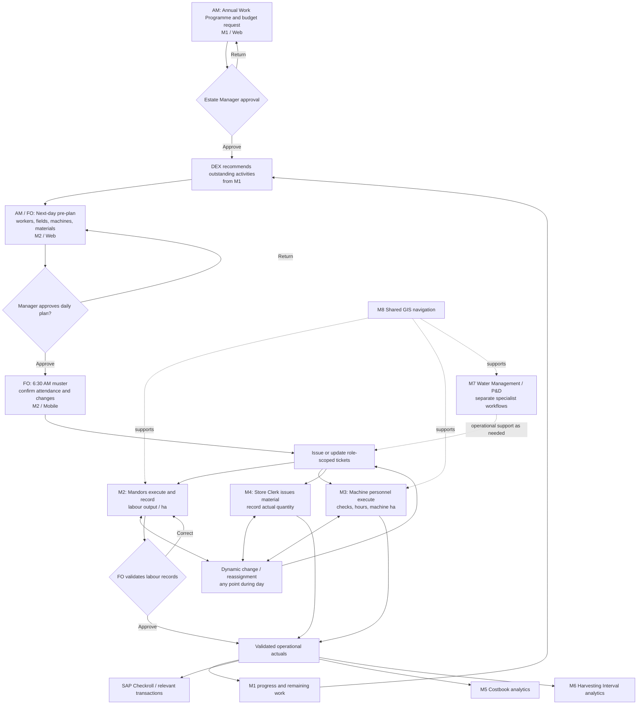
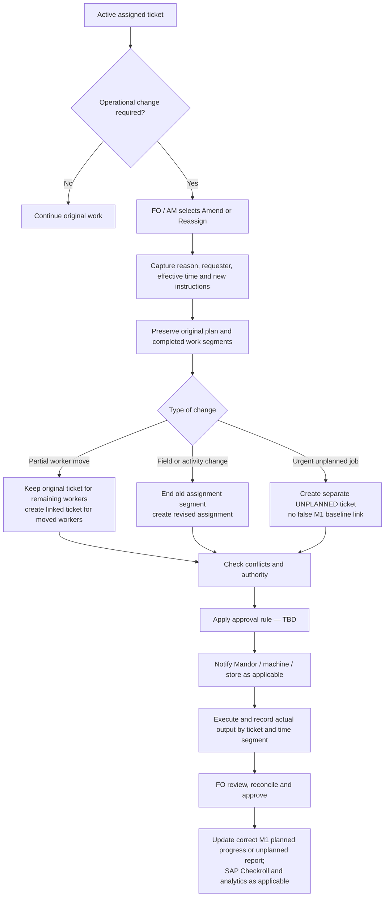
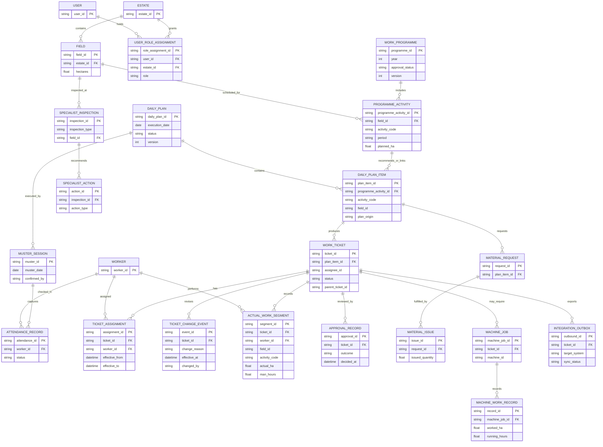

# DEX — Current Workshop Blueprint

Baseline: 18 October 2026.

## 1. Purpose

DEX is Digital Estate Extended: extending the existing Digital Estate concept to other estates.

Build an illustrative, freely navigable workshop prototype. It should make the operating process understandable, support discussion and answer participants' practical “what if” questions. Keep detail proportionate to this purpose.

The latest clarifications below define the current workshop scope. The supplied original blueprint is preserved in the appendix for continuity, including its broader future vision and earlier illustrative examples. Reference documents do not independently authorise new files, edits, integrations or deployment.

## 2. First workshop scope

| Module | Current coverage |
|---|---|
| M1 Work Programme | Programme creation/approval, field/activity/round planning, due/outstanding recommendations, validated progress and remaining work. |
| M2 Attendance, Job & Productivity | Daily pre-plan, approval, pre-muster summary, attendance, allocation, role-scoped labour tickets, harvesting/upkeep productivity, amendments, secondary work, corrections, FO validation and illustrative Checkroll preparation. |
| M3 Machine System | Show condition/PMV status, planning availability and existing allocations inside M2 Pre-Plan. Full checks, tickets and machine execution are deferred. Future eligible machine actuals also update M1. |
| M4 Warehouse | Show material codes, store, dummy on-hand/reserved/available stock and shortages inside M2 Pre-Plan. Preserve next-day preparation/issue request linkage. Full store-clerk tickets, physical issuance and returns are deferred. |
| M5 Costbook | Future reporting context. No separate detailed build or routine cost-input workflow in the first M1/M2 workshop. |
| M6 Harvesting | Existing Digital Estate Harvesting Interval may support field selection and relevant derived output around M2. No duplicate Mandor productivity input or separate major delivery stream. |
| M7 Upkeep | Specialised Water Management and P&D context, outside the first detailed build. Routine upkeep labour remains in M2. |
| M8 General Tools | GIS/navigation/shared tools context, outside the first detailed build. |

Do not build all eight modules to equal depth. The workshop revolves around M1/M2.

## 3. Connected demonstration

1. AM creates/reviews annual programme activities and rounds in M1. Manager approves the baseline.
2. M1 recommends due or remaining work. Selecting it pre-populates M2 activity, field and programme/round references.
3. AM selects one or more fields and target hectares, then allocates workers/gangs, EVIT resources and material requests.
4. Harvesting field selection may start from the existing Harvesting Interval view. Manual/general/unplanned activities also remain possible.
5. AM reviews an editable pre-muster summary and submits the daily plan. A notification and Manager queue reflect the submission.
6. Manager approves or returns the plan. Approval makes the plan available for its execution date.
7. FO conducts morning muster, confirms actual attendance, retains valid assignments and resolves absences/resource changes.
8. Confirm Activity creates/activates role-scoped labour tickets. AM/FO see the relevant overview; a Mandor sees their own current and past tickets.
9. Mandor accepts work, records productivity and submits. Harvesting detail can include field, task, cutter and bunches; upkeep can use field/group hectares with worker attribution as needed.
10. FO reviews, returns for correction or approves, retaining submission history.
11. Eligible approved actuals update the correct M1 field/activity/round once. Related harvesting output and an illustrative Checkroll preview can reflect those same records.
12. Remaining work informs later recommendations. New or urgent work remains distinguishable from the approved baseline.

## 4. Operational flexibility

Changes may occur during planning, muster or field execution. Preserve the original approved plan and previous actuals.

For a midday transfer, retain work performed before the effective time, close the moved workers' earlier assignment periods and create/update linked instructions for their new work. Workers remaining on the original activity continue there.

Record a short reason, actor, effective time and affected assignments/tickets. Notifications and ticket history must show the change. Avoid overlapping worker assignments and duplicate programme completion.

Unplanned work can be recorded without an M1 reference. Secondary jobs and piece/hourly examples must be easy to add. Approval authority, payment calculations and post-validation correction rules remain workshop assumptions rather than a complete production engine.

Going back to a screen does not undo a submitted action. Drafts can be edited; approved/active work uses amendment/correction actions with retained history.

## 5. Resource information inside Pre-Plan

### Machines

Use supplied EVIT identities/descriptions. Initial PMV/condition, availability, issues and existing assignments are simulated.

Show serviceability separately from planning availability. A working/ready machine may already be allocated. An idle machine may be serviceable and available, or unavailable pending a check/operator.

Allow the AM to see and understand conflicts before choosing resources. Detailed enforcement can remain a workshop discussion.

### Materials

Use selected real material codes/descriptions and the supplied storage locations. Stock balances, units of measure, reservations and thresholds are simulated.

Display requested quantity against available stock. Show sufficient, low, fully reserved and out-of-stock examples. Do not deduct physical stock merely because a pre-plan request is created.

Retain a future connection from the pre-plan's material request to the Store Clerk's M4 preparation/issue ticket for the next day. Full M4 processing is deferred.

### Future M1 feedback

Eligible M3 actual machine work also contributes to M1 progress. When implemented, reconcile the field/activity/round completion with M2; do not sum duplicated labour and machine hectares.

## 6. Web, Phone and Workshop views

- **Web View:** office planning, Manager approval, overview, programme monitoring and reports.
- **Phone View:** focused mobile screens for FO muster, Mandor tickets/productivity and relevant validation.
- **Workshop View:** built-in interactive web and phone-sized panels side by side within one browser tab.

Each Workshop panel selects its role independently, for example AM on the left and FO/Mandor on the right. Both use the same records. Actions in one panel update the relevant queue, notification or output in the other.

Support enlarging either panel and returning to Workshop View. Changing roles/views preserves progress. The phone panel uses the actual mobile interface.

A workshop clock can advance from preparation day to muster, midday and end-of-day without replacing the session. Physical-phone live synchronisation is a separate optional extension; one browser's storage does not share edits with another device.

## 7. Exploration and optional scenarios

Free exploration is the default. Participants can create, review, amend and revisit records within the agreed workflow.

Load Scenario prepares linked records at a chosen starting point, not a fixed click-through or an automatically completed outcome. Suggested presets:

| Scenario | Starting situation | Participant interaction |
|---|---|---|
| Normal day | Approved programme and familiar available resources. | Build the pre-plan and complete the operating journey. |
| Morning disruption | Approved pre-plan and assigned workers ready for muster. | Mark absence or change resources and confirm revised allocations. |
| Midday reassignment | Active labour tickets and partial morning output. | Move workers while preserving earlier work and instructions. |
| Urgent activity | Existing work in progress. | Add an unplanned/secondary job and resolve allocations. |
| Productivity correction | Mandor submission awaiting FO review. | Return, correct, resubmit and approve. |

Keep optional Load Scenario, Reset and clock controls in Workshop Tools. Confirm before replacing/resetting current progress. Scenario changes do not alter reference masters.

Notifications should combine a concise confirmation, a persistent inbox link and ticket/plan history where useful. They must reflect real state changes in the simulation.

## 8. Data approach

Use the supplied E063 master records to make selections recognisable. Keep every populated non-material list and a manageable, varied material sample. Create dummy operational values wherever the extract lacks data.

The foundation contains 64 material codes: eight each for fertiliser; spraying chemicals; PPE; machinery parts; fuel/lubricants; harvesting tools; spraying equipment; and general supplies.

Separate supplied references from simulated operational records and retain source-row tracing. A simple Workshop Simulation notice and clear quantity/context labels are sufficient; avoid cluttering every field.

The initial resource snapshot uses a simulated 17 October 2026 preparation time and 18 October planning date. Exact dates, units and quantities are demonstration assumptions.

Do not depend on the original workbook or OneDrive at workshop runtime. Do not treat material selections as current SAP active/stock confirmation or chemical/machine suitability advice. No real external integrations, payments or operational assignments occur.

See [Data guide](../data/reference/README.md) for counts, mappings and preparation details, and [Decisions](DECISIONS.md) for source gaps.

## 9. Reuse plan

| Existing implementation | Retain where suitable | Adapt/connect within DEX |
|---|---|---|
| Work Programme | Programme governance, Monthly/Daily views, rounds, approved completion, tables/maps. | Feed recommendations to M2 and receive eligible validated actuals. |
| Pre-Plan | Programme cards, gang/worker filtering, individual/group drag-and-drop, per-worker fields, summaries and draft behaviour. | Add field targets, resources, approval, muster, timed/multiple jobs and tickets. |
| Digital Estate Harvesting Interval | Harvesting Report, Field Status, interval and production/dispatch distinction. | Support field selection and the relevant M2 actual feedback. |
| PMV | Familiar condition/status concepts and EVIT references. | Show simulated planning availability now; detailed M3 processing later. |

Historical Pre-Plan's one-programme-per-worker/day and finalisation lock do not fit DEX's dynamic assignments. Preserve the historical implementation and adapt the DEX copy.

Keep the Minamas harvesting prototype separate. It has different established rules. Do not copy credentials, historical API hooks or browser-storage keys into DEX.

## 10. Design

Use green accents, white/light backgrounds, clear typography, restrained cards and a clean minimalist layout. Keep ordinary work screens focused on the action and essential fields.

The video improves understanding of the vision, estate context and intended experience. It is an older reference: its M6 Geospatial corresponds to current M8 Tools, its M7 Harvesting to current M6, and its M8 Upkeep to current M7.

Keep technical implementation detail out of participant-facing workflows.

## 11. Working and delivery setup

Keep DEX in the existing digital-estate-app repository under its own dex-prototype application subfolder. Preserve historical files, documentation and previous requirements.

Run all creation/development/validation in the Ubuntu VM. The Mac hosts shared Dropbox files and supports review/presentation.

DEX is the sole intended future deployment. A new subfolder alone does not change the existing deployment target; configuration and release remain future explicitly authorised actions.

Current approved foundation: project README, DEX AGENTS, blueprint, decisions, eleven reference JSON datasets, their README and two resource scenario JSON datasets.

Next stages:
1. Review the reference pack and source issues.
2. Agree application filenames and adapt the first M1 recommendation / AM Pre-Plan / FO Phone / Workshop layouts.
3. Build the shared state and one complete normal-day journey.
4. Add operational changes and optional scenario presets.
5. Validate connected behaviour, desktop/mobile layouts and the workshop reset.

No application runtime, component copying, Git push or deployment is included in foundation creation.

## 12. Workshop acceptance

- Explain and demonstrate the M1/M2 process using familiar reference data.
- Select a recommendation and obtain prefilled activity/field/round details in M2.
- Show simulated machine/material availability during planning.
- Submit/approve the plan, conduct muster and create relevant labour tickets.
- Switch web/phone/panel roles while retaining the same records.
- Record productivity, return for correction and approve.
- Preserve prior work during amendments and keep unplanned work distinguishable.
- Update eligible programme progress once, based on validated work.
- Navigate freely and reload/reset scenario starting points deliberately.
- Support practical discussion of roles, handoffs, exceptions and unresolved rules.

---

# Appendix — Supplied Original Blueprint

The following text is retained verbatim from the supplied README, except for this enclosing appendix heading. It documents the wider vision and earlier examples. The current workshop clarifications above and subsequent explicit user instructions determine the delivery scope.

# DEX — Estate Operations Prototype & Workshop Blueprint

> **Purpose:** Handover context for building an interactive DEX (Digital Estate Extended) workshop prototype. This README consolidates the business vision, issued RFP scope, operating workflows, role access, example scenarios, proposed data design and decisions still requiring validation. It is **not** a signed-off technical design, verified SAP schema, or approved permission matrix.
>
> **Terminology:** Some discussions refer to the platform as **TACS** or “tax platform”; this document uses **DEX** consistently. Confirm official naming if necessary.
>
> **Intended audience:** Prototype developer, UI/UX designer, business analyst, SDG Group Digital team and workshop facilitators.

## 1. Executive summary

DEX is intended to unify existing estate workflows, including UA/SAP-related work and SAFE machine workflows, in a single connected user experience. Rather than merely reproducing existing screens, DEX should connect **annual planning → day-before planning → morning muster → ticketed field execution → validation → Checkroll/financial processes and management analytics**. Approved actual work feeds back to the annual Work Programme, so the next day's suggestions reflect what remains.

**Operating principle:** *Plan once, assign once, capture once, validate, and update the plan.* The approved plan is a **baseline, not a constraint**: an authorised user must be able to change assignments or introduce urgent work at any point during the day, preserving both planned and actual history.

**Platform split for the workshop:** **Web** for annual planning, daily pre-planning, managerial approvals and monitoring; **mobile** for muster, assigned-ticket execution, quick field changes, productivity recording and on-site validation. Certain functions (approvals, reassignment and validation) may be accessible on both.

**Prototype goal:** A functional, connected **hybrid prototype**—guided scenario simulations plus free exploration—rather than a static click-through or a production system. Priority is M1/M2 end-to-end behaviour, with representative connections to M3/M4 and reporting in M5/M6. Use mock data and simulated integrations; no real SAP/SAFE/SSO connection is required.

## 2. Business context and boundaries

- Managers and Assistant Managers prepare a **next-year annual Work Programme**, defining activities by field, area, frequency, timing, resource expectations and estimated costs. The programme supports budget requests/alignment with Finance, and the Estate Manager approves it.
- Daily pre-planning should be **recommended from the approved Work Programme**, highlighting due/outstanding activities; choosing one should auto-populate its activity code and field. The user then assigns workers/gangs, machinery and material requests.
- Daily pre-plans are submitted for Estate Manager approval, then used during ~6:30 a.m. muster the next morning.
- Muster records actual attendance, retains valid preassigned worker/activity/field mappings, and permits changes before work starts.
- Confirmed execution generates/updates work tickets appropriate to recipient role: labour Mandor in M2, machine staff in M3, store personnel in M4.
- Mandors capture **labour** work and productivity (including harvesting and routine upkeep) in **M2**, not again in M6 or M7. M3 captures **machine-specific** operations and actual machine work areas. M4 manages material transactions.
- Field Officers validate labour productivity and can return it for correction. Approved data supports SAP Checkroll and Work Programme progress. Payroll success need not gate the update of operational completion.
- Operations are subject to **firefighting**. Approved assignments can be revised even at 10–11 a.m. or later. New urgent/unplanned work may be assigned without falsely being recorded as original planned work.
- M5 is **reporting/analytics only**—no routine cost input. M6 is primarily **harvesting interval and performance output** using M2 plus tracker/geospatial data. M7 is a **specialised input-and-output** workflow for Water Management and Pest & Disease, generally distinct from the routine Work Programme. M8 is the shared GIS/navigation toolset.

## 3. Eight modules — latest scope

| Module | Classification | Responsibilities | Important boundary |
|---|---|---|---|
| **M1 Work Programme** | Planning & monitoring | Annual programmes, per-field activity timing/frequency, resource estimates, budgets, approvals, versioning, daily recommendations, planned vs actual and remaining work | Routine planned activities' progress returns here. It is **not** every estate record's destination. |
| **M2 Attendance, Job & Productivity** | Labour operational / transactional | Day-before pre-plan; attendance/muster; gang/worker allocation; role-targeted tickets; worker productivity, man-hours, bunch/out-turn and hectarage; exceptions/reassignment; FO approval; Checkroll integration | **Primary data-entry/validation point for labour productivity**, including harvesting/upkeep Mandors. |
| **M3 Machine System** | Machine operational / transactional | Machine/operator assignment, tickets, pre/post operation checks (PMV), running/idle/breakdown, hours, GPS/movement, worked-area calculation, machine productivity, maintenance/issue records | Machine work/area inputs live in M3, with coordinated references to M2 and M1; do not duplicate labour data. |
| **M4 Warehouse** | Material/inventory operational / transactional | Material planning and requests, reservations/preparation, store issuance, receipt/stock movements, returns, consumables, inventory and procurement SAP exchange | Distinguish **day-before material request** from **execution-day physical issuance**. SAP remains authoritative for inventory/procurement. |
| **M5 Costbook** | Reporting & analytics | Labour/material/machine and other costs; budget comparisons; cost per hectare; financial dashboards and variance | **No routine operational cost data entry**. Consolidates validated records from M2/M3/M4 and SAP. |
| **M6 Harvesting** | Reporting & analytics | Digital Harvesting Interval, table/map field coverage, overdue areas, harvesting and harvester performance, supplementary GPS/tracker/bunch-cut data | **No second harvesting Mandor productivity entry**. Primary operational harvesting records come from M2. |
| **M7 Upkeep** | Specialised input & output | Water Management and Pest & Disease (P&D) census/inspection, water readings, GPS/palm/area tags, assessments, treatments, follow-up and dashboards | Unlike routine upkeep labour in M2, these specialised workflows often originate outside M1's annual plan. Field labour execution can coordinate with M2 if needed. |
| **M8 General Tools** | Shared utilities | GIS mobile maps/navigation, offline maps, placemarks, routes, measurements, geotagging, cross-module location tools | Initial delivery focuses on GIS; it is not another operational productivity-entry module. |

### Existing product context from issued RFP

- **M1:** SDG Palm Digital Work Programme sub-module under internal development.
- **M2:** Existing internally developed Muster Chit (must be preserved/integrated or enhanced).
- **M3:** Palm Digital Drive and existing GIS Mobile App; SDG controls and approves the final machine hectarage determination methodology. Vendor may propose implementation/enhancements, not unilaterally redefine the accepted method.
- **M4:** Palm Digital Fertiliser Management capabilities (AFR recommendations through purchasing and goods receipt).
- **M6:** Internally built Harvesting Interval and Harvesting Tracker reporting/device integration.
- **M7/M8:** Existing GIS Mobile App foundation, including offline/location tools.
- Issued RFP allows vendors to reallocate shared capabilities **if total coverage is preserved and pricing/capability allocation remains traceable**. Detailed stories, acceptance criteria, integration and role permissions are refined during Blueprint.

## 4. Primary actors and preliminary access model

This is a **proposed**, workshop-testable role matrix; authoritative permissions are **TBD during Blueprint**. Access should also be scoped by estate, gang, ticket ownership and other relevant assignments.

| Role | Primary surface | Sees / does | Proposed boundaries |
|---|---|---|---|
| **Estate Manager** | Web; mobile approval optional | Approves annual Work Programme and daily pre-plan; sees overview, exceptions, changed-vs-original plans | Approval authority for major intraday changes TBD |
| **Assistant Manager (AM)** | Web + mobile | Builds annual plan; prepares daily plans, assigns gangs/workers/machines/materials, supervises changes | Delegated change/approval rights TBD |
| **Field Officer (FO)** | Mobile + web | Conducts muster; confirms/reallocates assignments; monitors tickets; reconciles and approves Mandor productivity | May amend during the day subject to authority rules; final labour validator in proposed flow |
| **Harvesting Mandor** | Mobile, **M2 My Tickets** | Only assigned harvesting tickets; reviews assigned workers/activity/field; records individual worker out-turn/man-hours and applicable output; submits | Cannot approve own submissions or view unrelated gangs |
| **Upkeep Mandor** | Mobile, **M2 My Tickets** | Only assigned routine upkeep tickets; records labour output and worked hectares; submits | Cannot approve own submissions or edit other gangs |
| **Machine Specialist / Machine Operator** | Mobile, **M3** | Assigned machine tickets, pre-checks, work status, operating hours, actual work/hectarage, issues and closure | Machine record approval rights TBD |
| **Store Clerk** | Mobile or web, **M4** | Sees material requests, prepares and issues, records actual issues/returns | Issuance approval/control per SAP governance TBD |
| **Finance / Cost Reviewer** | Web, **M1/M5** | Budget alignment and consolidated cost reporting | M5 read-only reporting, not cost transaction entry |
| **Water Management / P&D personnel** | Mobile + web, **M7** | Specialist census/inspections, GPS-tagged records, assessments, treatments, monitoring | Specialist approval rights TBD |
| **Management / harvesting supervisor** | Web, **M6** | Views Harvesting Interval, coverage and performance dashboards | No duplicate Mandor data entry |
| **Estate personnel** | Mobile, **M8** | GIS navigation and location tools, as authorised | GIS permissions and offline behaviour TBD |

Role-based navigation is central to the prototype: switching roles should change the visible menu, ticket scope and available actions while preserving the **same simulated operational state**.

## 5. End-to-end normal process, in chronological order

### Stage 1 — Annual programme and budget (M1, web)

1. AM uses field/ha, target activity, frequency, schedule, labour/machine/material estimates and budget expectations to prepare next-year programme.
2. Example: **Field 2024A**, **manuring**, **3 rounds/year** (e.g. February/June/October); estimated costs relate to field/activity/account references.
3. AM and Estate Manager review; Manager approves or returns for revision.
4. Approved programme becomes operational and budget baseline. Budget approval/allocation workflows involving Finance must be aligned but exact interface/authority is TBD.

### Stage 2 — Next-day pre-plan (M2, web)

1. On **17 October**, AM/FO plans **18 October**.
2. DEX recommends due/uncompleted work from M1: e.g. October manuring for Field 2024A.
3. Selecting recommendation **auto-fills activity code and field**; AM/FO assigns gang/workers, planned ha, machinery/event reference and required materials/quantities.
4. New or manual additions must also be supported if needed; mark them as planned-linked or unplanned as appropriate.
5. AM/FO submits; Estate Manager approves/returns.
6. Material **request/reservation** is exposed to M4. This is *not* yet confirmation that materials were physically issued.

### Stage 3 — Morning muster (M2, mobile, about 6:30 a.m.)

1. FO/AM opens yesterday's approved plan and takes **actual attendance**.
2. Present workers keep their assignments where possible; absences flag missing allocations.
3. FO/AM may change gang, workers, activity, field or resource plans because of rain, unavailable machines, etc.
4. Confirmed muster establishes the day's **current execution plan** with retained original-plan history.

### Stage 4 — Automatic tickets (M2/M3/M4)

1. On muster confirmation, DEX creates or activates role-scoped work instructions/tickets.
2. **M2:** Harvesting/upkeep Mandor sees only relevant labour tickets in **My Tickets**.
3. **M3:** Machine staff receives corresponding machine work tickets.
4. **M4:** Store Clerk sees material needs/issue instructions; actual stock issuance is recorded when it happens.
5. Ticket information contains linked activity, field/location, date, workers, applicable resources and expected output.

### Stage 5 — Execution and data capture (mobile)

- **M2 Mandors:** accept ticket, perform work, record **labour productivity** (individual or team as required), hectares, man-hours, bunch counts and relevant activity-specific output; submit ticket.
- **M3 machine staff:** pre-work PMV/availability; record machine status, hours, movement, hectares and issue reports; close/submit machine ticket.
- **M4 store:** issue actual material quantities against linked request/activity/field, process returns/adjustments as permitted, synchronise appropriate SAP transactions.
- Users may change assignments **at any time**, not only during morning muster: see §6.

### Stage 6 — End-of-day validation (M2, mobile or web)

1. Submitted Mandor tickets reach the FO's validation queue.
2. FO checks worker, activity, field, effective working periods, hectarage/output and exceptions.
3. FO **approves** or **returns for correction**; corrected submissions preserve earlier versions/audit history.
4. Machine and warehouse transaction validation happens in M3/M4 according to their respective authority rules; do not imply FO is the universal approver for every transaction.

### Stage 7 — Downstream integrations and loop closure

- **M1:** approved actual work adds to corresponding programme completion, correctly counting only relevant work. Remaining/delayed tasks inform later recommendations.
- **SAP Checkroll:** validated worker attendance/productivity/out-turn records feed payment processing; data entered once. Interface details, approval and error/retry rules TBD.
- **M5:** derives cost and cost/ha analytics from confirmed operational information plus SAP financial records, with **no extra manual cost input**.
- **M6:** derives harvesting interval/field coverage and tracker-based insights from M2 plus device/GIS/rainfall inputs as applicable; **output/reporting**.
- **M7:** specialised water/P&D processes can run independently; where they use routine field labour/resources, reference M2/M3/M4 without duplicate productivity entry.
- **M8:** reusable GIS/navigation services support location work across modules.

### Main workflow — Mermaid

**Interpretation:** Diagram shows a *conceptual* handoff, not strict synchronous sequencing or approval of all streams at one instant. Labour validation is explicit; machine and materials have their own relevant validation controls. The data links between external systems are subject to Blueprint.

## 6. Operational firefighting: changes ANY time during execution

The confirmed morning plan is **not locked**. Weather, urgent management instructions, staff absence, machine failure and field conditions may require repeated changes after work starts.

### 6.1 Three operating cases

1. **Planned execution:** complete original authorised ticket as assigned.
2. **Adjusted execution:** move some/all workers, change field/activity/machine/material or split a ticket while work is in progress.
3. **Unplanned execution:** add a new urgent activity that has no original M1 work-programme reference. It must be separately identifiable for reporting, costing and payment.

### 6.2 Suggested “Amend / Reassign” flow in M2

1. **Authorised FO/AM opens active ticket** and chooses `Amend / Reassign` (Mandor may request/report a change, not necessarily directly authorise it).
2. Choose change type: worker transfer; activity/field change; resource change; partial halt; cancel remaining work; create urgent work.
3. Record **reason, effective time, requested by, changed by**, old/new assignments and relevant instruction/reference. Candidate reasons: management direction, rain, manpower shortage, machine breakdown, urgent work, other.
4. **Snapshot work completed to that time**; previously entered worker hours/output/ha remain attached to the original activity/field for the earlier period.
5. Reassign only **remaining work / effective period**. For partial team move, original ticket continues for workers who remain; moved workers receive a new/revised linked ticket.
6. Check worker/machine double-booking, material implications and possible budget impact; flag conflicts.
7. Apply the required authority/approval path (minor adjustment vs material deviation: **TBD**).
8. Update ticket versions/statuses and notify old/new Mandors, affected machine personnel and Store Clerk. Old records are **not erased**.
9. At the end of day, FO reconciles **original plan → revisions → actual output** and approves appropriate transactions.
10. Feed validated work to M1 only where **properly linked to an actual planned item**. Unplanned work is reported distinctly, not silently credited to unrelated annual-plan targets.

### 6.3 Example — 10:30 a.m. reassignment

- 06:30: five workers confirmed for manuring, Field 2024A.
- 07:00–10:30: all five work on original ticket and record valid partial output/time.
- 10:30: Manager instructs FO to move **two workers** to urgent Field 2023C work.
- 10:45: FO amends assignments; **three** workers continue original ticket; two receive linked urgent tickets.
- End of day: each labour segment is attributed to its correct field, activity, time interval and worker; FO checks both tickets. M1 only receives eligible planned output; M5 can analyse planned/unplanned costs.

### 6.4 Suggested ticket and audit model

- **Plan baseline:** immutable approved snapshot and subsequent programme/pre-plan versions.
- **Ticket identity:** persistent ID, activity/field, owner, current status; optional `parent_ticket_id` and `supersedes_ticket_id` for split/reissue.
- **Assignment history:** person/machine + start/end effective times (not just a single overwriteable worker list).
- **Change event:** previous values, new values, reason, effective time, actor, authorising person, timestamp and affected ticket IDs.
- **Actual work segment:** dated/timed quantity, worker, activity/field and ticket version (retained when assignment changes).
- **Approval/return:** actor, time, decision, reason, correction versions.
- **Integration status:** pending/sent/acknowledged/failed/retried, where outbound to SAP/other systems.

### 6.5 Decisions to validate in Blueprint

- Can FO amend independently or only request? Which thresholds require Manager approval or post-hoc authorisation?
- Does reassignment take effect immediately, or must the receiving Mandor accept it?
- How is partial-day labour productivity and pay calculated if workers change activity multiple times?
- How are already-issued materials, machine allocations and work completed before the change reconciled?
- What happens when mobile devices are offline or reassignment messages have not synchronised?
- What are cutoff rules for changes after Checkroll submission or payroll processing?
- Should urgent work be reclassified to an approved programme later, with explicit audit/authority?

### Midday change flow — Mermaid

## 7. Workshop prototype — recommendation

### 7.1 Delivery style

Build **one connected hybrid prototype** with:

- **Guided scenario selector** to initialise repeatable situations and prefilled datasets.
- **Free-exploration mode** for participants to navigate and try actions.
- **Role switcher** for Manager, AM, FO, Harvesting Mandor, Upkeep Mandor, Machine Specialist/Operator and Store Clerk.
- **Shared simulated state**: creating a plan updates the manager queue; approval enables muster; muster creates visible mobile tickets; ticket revisions immediately appear in the receiving role; approved actuals update M1 and reporting.
- **Reset scenario** ability so each workshop group begins from identical data.
- **Web and mobile layouts**; ideally presenter can show planning on web and execution on a phone-size panel or device.

Avoid building SAP integration, production SSO, comprehensive ERP transactions, every M1–M8 feature or production infrastructure for this validation workshop. A local/mock backend or shared in-browser state is sufficient for one demonstration; multiple concurrent participants require suitable shared backend state/isolation.

### 7.2 Prioritised screens

| Surface | Role / screen | Must demonstrate |
|---|---|---|
| **Web** | M1 annual Work Programme | Field/activity/frequency, approved plan, due/outstanding and completed ha |
| **Web** | M2 next-day pre-plan | M1 recommendation → activity/field autopopulation → workers, machine, materials → submit |
| **Web/mobile** | Manager approval and overview | Approve/return; view daily progress, exceptions and original vs revised assignments |
| **Mobile** | FO morning muster | Attendance, absent-worker impact, confirm and adjust allocations |
| **Mobile** | Mandor My Tickets | Role/assignee restricted tickets; accept, see details, enter productivity and submit |
| **Mobile** | FO Amend / Reassign | Move workers mid-shift, split ticket, urgent activity, impact overview |
| **Mobile/web** | FO validation | Compare submitted vs expected, approve or return with reason |
| **Web** | M1 progress and M5/M6 outputs | Approved actuals flow into programme, cost illustration and Harvesting Interval preview |
| **Mobile, light mock** | M3 / M4 | Linked machine ticket and material request → issue confirmation |

### 7.3 Five repeatable guided scenarios

| Scenario | Setup and user journey | Specific questions for workshop |
|---|---|---|
| **S1 Normal day (happy path)** | Oct planned manuring recommended → AM assigns → Manager approves → FO muster → Mandor works/submits → FO approves → M1 updates | Is the everyday workflow fast and realistic? What inputs are truly necessary? |
| **S2 Morning disruption** | Two of five planned workers absent or rain changes field → FO adjusts before dispatch → tickets regenerated | Automatic removal vs manual confirmation? Who may alter the approved pre-plan? |
| **S3 Midday reassignment** | Five workers on Field 2024A; ~10:30 two moved to Field 2023C; partial work retained; revised tickets visible | Permissions, effective times, split ticket, notifications, partial-day pay/output and approvals? |
| **S4 New urgent activity** | Road clearing or equivalent work not in M1 → FO creates urgent ticket, resolves resource conflicts, records output | Can work start before management approval? How should unplanned work/budgets be categorised? |
| **S5 Productivity dispute** | Mandor submits 20 ha; FO finds 16 ha; return/correct/resubmit/approve | Which records count for Checkroll and M1, and when? How is history preserved? |

Suggested workshop facilitation: demonstrate S1, then S3/S4 (most revealing), then S2/S5; let managers try the same flows themselves. Capture **workflow practicality, role authority, exception handling, data ownership/integration and decisions**. Avoid treating prototype clicks as confirmed requirements.

### 7.4 Mock test data (illustrative, not real estate master data)

- Estate: `Demo Estate`; field `2024A`, 100 ha; annual manuring 3 rounds (Feb/Jun/Oct), October round outstanding.
- On 17 Oct create 18 Oct plan: manuring `2024A`, target 20 ha, 5 workers, fertiliser requirement, optional machine.
- Another field: `2023C`, used for urgent reassignment.
- Workers A–E; Harvesting and Upkeep Mandor role profiles, FO, AM, Manager, Machine Specialist and Store Clerk.
- Reassignment: workers A/B move at 10:30/10:45; other three remain. Separate pre-/post-change actuals.
- Validation: 20 ha submitted, 16 ha approved. **Illustrative figures**, not operational productivity standards.

## 8. Recommended prototype state and business rules

1. **Web/mobile share one data model and event stream.** The app may simulate responsive clients; actions must update the same records.
2. **Suggested tasks must respect actual progress:** do not recommend a fully completed round simply because the original calendar says October; highlight overdue/outstanding planned work.
3. **Pre-plan status:** Draft → Submitted → Approved / Returned → Ready for Muster.
4. **Muster:** attendance confirmation changes availability; keep historical planned assignments and capture adjustments.
5. **Ticket status (proposed):** Draft / Assigned → Accepted → In Progress → Submitted → Approved or Returned; allow Cancelled / Superseded / Partially Reassigned where needed. Do not erase completed work during cancellation/reassignment.
6. **Effective-dated assignment segments:** enable multiple assignments for a person on the same date while detecting overlapping intervals.
7. **Worker productivity belongs in M2** regardless of routine harvesting/upkeep activity; **machine productivity belongs in M3**. Shared field/worker references permit aggregate reports without double-entry.
8. **Material request ≠ material issuance:** request before work, confirm actual stock movement through M4.
9. **The M1 feedback loop consumes only validated, eligible completion.** Unplanned work is clearly distinguishable and not retroactively credited to an unrelated scheduled activity.
10. **Checkroll output is a separate controlled downstream process**. Failed SAP transmission should not delete locally approved operational records.
11. **Reporting M5/M6 is read-only output**, subject to actual upstream records; M7 is a separate specialised input+output module.
12. **Auditability:** preserve original approved plan, all changes/actors/times/reasons, submission corrections, and external sync outcomes.
13. **Offline field operation** is a target requirement from the wider RFP; conflict-resolution design is TBD. For workshop simulation, visibly distinguish pending sync if demonstrating offline behaviour.

## 9. Suggested conceptual data model (not a SAP ERD)

> Illustrative platform/domain entities only. Do not interpret these as confirmed physical tables, keys, SAP T-codes or real API schemas.

**Data-model cautions:** Actual integration may require separate worker/employee SAP identities, gang membership, machine masters, material IDs, programme rounds, many-to-many field/activity relations, and allocation of a single ticket across several workers/fields. The prototype can use a simpler implementation while preserving intended process behaviour. Exact checkroll/payroll, geospatial and cost allocation schemas must be validated with IT/business teams.

## 10. Integration vocabulary for workshop mapping

The UI flow mapping was intentionally reduced from 10 columns to **six business-friendly columns**:

`Step | Field / Action | Input Method / Logic | Data Source | Data Interaction | Remarks / Validation`

### Fixed dropdown legends

**Input Method / Logic:**
- `Manual` — user types or enters a value.
- `Selection` — user chooses an option.
- `Auto-populated` — system fills from existing records.
- `Derived` — system calculates/determines it via a rule.
- `Action` — user triggers a function (save, approve, sign in).

**Data Source:**
- `SAP` — originates in SAP.
- `SAFE` — originates in SAFE.
- `DEX` — created/owned/maintained in DEX's own environment (not merely displayed there).
- `Multiple` — combination of sources.
- `SSO` — identity/authentication provider.
- `TBD` — not validated.

**Data Interaction:**
- `READ` — retrieves from an external system without changing that source.
- `WRITE` — submits new/updated information to external system.
- `READ + WRITE` — both retrieves and submits.
- `LOCAL` — internal processing/storage without external integration.
- `N/A` — purely navigational/no data exchange.
- `TBD` — uncertain.

**Important distinctions:**
- Picking a **Gang dropdown** is a `READ` from SAP, *even when the selected gang ID later appears in a different transaction*. Do not imply the Gang Master itself gets updated.
- A **material count** workflow may involve `READ + WRITE` (reference material information + submit issued/used quantities), dependent on the confirmed SAP transaction design.
- Avoid claiming table names such as `SM2WORK` are correct. Keep table, field and API mapping in a **separate technical worksheet** for IT verification.
- Prefill `Remarks / Validation` with concise **`Logic:`** for documented known behaviour and **`Validate:`** for workshop questions. Use `TBD` rather than inventing integrations or ownership.

## 11. Explicit assumptions, open questions and required validation

**Confirmed direction from conversation / RFP:**
- Work Programme is planning baseline and receives eligible actual-progress feedback.
- M2 centrally owns **labour** attendance/job/productivity inputs and role-scoped Mandor tickets.
- M3 and M4 handle machine and warehouse transactions.
- M5 has **no operational manual data input**; M6 is principally harvesting monitoring output.
- M7 supports specialised Water Management/P&D inspection, input and reporting outside normal Work Programme where applicable.
- Real-life operations require **intra-day changes** and unplanned work, without losing historical attribution.
- Prototype emphasises **web planning + mobile execution**, guided scenarios and exploratory interaction.

**Not finalised (do not hard-code as a contractual/business fact):**
1. Which roles may amend which tickets, whether managers must reapprove major changes, and emergency bypass rules.
2. Whether manager approval is always required for every daily pre-plan and under what delegation rules.
3. Precise sequence/ownership of morning muster, ticket acceptance, reassignment and material reservation/issuance.
4. Whether amended tickets are reissued or versioned and exactly how Mandors confirm receipt.
5. Which field/worker productivity metrics are mandatory per harvesting/upkeep activity; unit and payment calculations.
6. Rules for crediting hectares to programme completion, repeat rounds, partial fields and duplicate efforts.
7. Machine hectarage methodology, thresholds, movement inputs and variance approval per SDG direction.
8. SAP/SAFE/Wialon/Katsana or other vendor API source-of-truth and read/write boundaries, plus offline sync.
9. SAP Checkroll payloads and payment reconciliation; reversals/amendments after submission.
10. Costbook calculation, cost-source timing, allocation rules and budget oversight of urgent activities.
11. Which M7 specialist actions become M2 execution tickets and what they update after completion.
12. Role-level estate/gang/assignment scoping, approval matrix and data retention requirements.

## 12. Implementation brief for the prototype developer

**Build order (suggested):**

1. Seed mock estate, fields, annual programme, workers/gangs, activities, machines and materials.
2. Implement one coherent **state model** with annual programme, approved pre-plan, muster, tickets, assignment history, actual work segments, approvals and notifications.
3. Web: M1 recommendations + M2 pre-planning + Manager approval.
4. Mobile: FO muster + Mandor My Tickets + productivity capture + FO approval.
5. Critical exception workflow: live partial-day reassignment and urgent unplanned ticket with preserved prior actuals.
6. Add simulated M3/M4 ticket and issuance links, then M1 dashboard update and illustrative M5/M6 read-only output.
7. Add role switcher, scenario selector, reset, audit/change history and clear status indicators.
8. Test every scenario end-to-end using the same linked records, including user changes mid-demo.

**Definition of done for workshop prototype:**
- Selecting an M1 recommendation creates a prefilled M2 daily-plan item.
- Manager approval changes plan availability for muster.
- Muster can remove absent workers and finalise assignments; correct roles receive tickets.
- Mandor sees only assigned tickets, enters work and submits.
- FO can send a submission back and ultimately approve it.
- Reassignment does not lose original plan or previously recorded productivity; affected tickets refresh.
- Urgent unplanned ticket records are visibly separate from M1 planned completions.
- Approved actuals update the illustrated M1 remaining work; M5/M6 display suitable derived outputs.
- Web planning and mobile execution demonstrate the **same state**, using mock data, with restartable guided scenarios.

## 13. What this README is NOT

- Not an approved full ERD, SAP schema, physical architecture or integration contract.
- Not a replacement for the issued RFP, Appendix D, functional Blueprint, user stories or acceptance tests.
- Not authorisation to introduce features, integrations or approval policy without business validation.

**One-sentence vision:** *DEX turns the approved annual plan into daily field assignments, tolerates real operational change, captures actual work once at source, validates it, and continuously feeds the right systems and dashboards without duplicate manual entry.*
